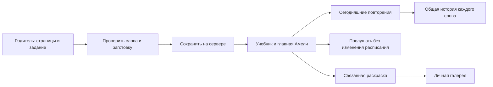

# Семейный сценарий: родитель → задание → Амели

Актуально для `2026.10.23-family-reliability-1`. Это одна семья с отдельными входами `parent`, `amelie`, `demo`, `sandbox`. Доступ и прогресс уже перенесены; повторный первичный импорт не нужен. Демо и Песочница предназначены для экспериментов взрослого.

## Как пользоваться сейчас

Родитель открывает «Для родителей» → «Учебник и задания». Указывает **печатные** страницы, что задано и срок, выбирает существующие слова. Если слова нет, добавляет его в той же форме: уже введённые страницы и выбранные слова сохраняются. Можно связать задание с одной из доступных раскрасок. Нажатие «Добавить задание» публикует его; сообщение подтверждает сохранение сервером либо прямо говорит об ожидании связи.

У Амели задание появляется в пункте нижнего меню **«Учебник»**, на главной показываются первые два активных задания и ссылка на все остальные. В карточке задания есть:

- «Повторить сегодня» — карточки по общему расписанию, с приоритетом школьных слов и прежним дневным лимитом.
- «Послушать слова и посмотреть расписание» — доступно в любой день, не меняет интервалы и не начисляет звёзды.
- «Немного порисовать» — если взрослый выбрал связанную раскраску.

Когда карточки на сегодня закончились, приложение говорит об этом; оно не утверждает, что всё школьное задание выполнено. Само задание завершает взрослый. После завершения его слова остаются в общей очереди повторений. Просроченный срок не обнуляет интервалы и не увеличивает нагрузку.

В готовых заготовках есть шесть занятий по проверенным страницам 66–68 Spotlight 2, часть 1. По два слова, сначала слух и картинка, затем чтение по желанию. Выбор заготовки только заполняет форму. До явного сохранения ребёнку ничего не назначается. Это предложения, а не автоматически приписанное учителю домашнее задание. Подробная карта книги: [spotlight-2-part-1.md](spotlight-2-part-1.md).

## Короткое занятие ребёнка

Ориентир — 5–10 минут, можно остановиться раньше. Один урок содержит не более шести карточек; кнопка «На сегодня хватит» завершает текущую попытку, остальные сроки сохраняются. Длинная очередь после перерыва не превращается в обязательное занятие на десятки карточек. Взрослый может выбрать 1–2 новых слова в настройках; существующий выбор не меняется обновлением. Сначала два знакомых звучания, потом маленькая игра, по желанию раскраска. Буквы доступны в «Words → ABC»; чтение и сборка слов не являются обязательным входом в занятие. Ошибка возвращает слово к короткому интервалу, не отнимает звёзды и не портит серию.

Открытие пустого урока не засчитывается за выполненное занятие. Сохранённая непустая свободная раскраска засчитывается как рисование. Выход из игры отменяет её таймеры; игра не продолжает начислять награды на другой странице. Быстрые повторные нажатия на ответ не дают повторных звёзд.

## Наклейки и место в альбоме

За участие начисляются звёзды. Первая наклейка нового альбома — за 15, следующие промежутки: **18, 22, 27, 33, 40, 48, 58, затем по 60**. Это рост примерно на 20% с ограничением. Неограниченная экспонента сделала бы поздние награды недостижимыми. Звёзды — отметка участия, а не оценка владения английским.

Старые награды сохраняются. У существующего профиля переход начинается от следующего прежнего рубежа в 15 звёзд; приложение не пересчитывает прошлое и не требует «заработать заново» уже полученные наклейки. Новые иллюстрированные наклейки продолжают коллекцию после прежних двадцати; затем набор циклически повторяется. Это не обещание бесконечного числа уникальных рисунков.

Кубок за слова + игру + рисование/ABC — отдельный бонус, не более одного за календарный день устройства. Он не отдаляет наклейку за звёзды. Нет штрафов за пропуски и требования обязательно завершать три занятия.

В альбоме **20 мест на лист**. Страницы переключаются, новый лист появляется автоматически; последний содержит свободное место. Все наклейки остаются в базе и экспорте. Количество не ограничено числом видимых ячеек. Одинаковые сохранения рисунка группируются в галерее, но исходные записи и даты не удаляются.

## Фотография задания: три варианта

| Вариант | Что делает родитель | Что происходит | Статус |
| --- | --- | --- | --- |
| Сразу выбрать слова | Вводит страницы, задачу, слова и раскраску | Сохранённое задание сразу видно Амели | Работает, без платных API |
| Подготовка через владельца и чат | В форме нажимает «Скопировать запрос на подготовку», передаёт владельцу текст и фотографию | Владелец приносит их в чат; помощник проверяет материал, готовит набор с прежними id и черновик; взрослый публикует | Копирование запроса работает; фото передаётся вручную, в приложение не загружается |
| Фото внутри приложения | Загружает фото и поясняет задание; клавиатурная диктовка может заменить набор текста | Сервер хранит приватный материал, распознаёт его, показывает проверяемый черновик; взрослый публикует | Следующий этап, пока не реализован |

**Рекомендация для этой семьи: сначала первые два варианта.** Слова, расписание, раскраски и базовые школьные заготовки уже есть. Это позволит проверить реальные потребности без расходов на автоматическую генерацию при каждом открытии.

Чтобы попросить подготовку через чат, достаточно: книга/издание, печатные страницы, упражнение/срок, фото или текст, нужные слова, пожелание к рисунку. Не нужно пересылать пароли или полный прогресс ребёнка. Помощник не получает автоматическое уведомление от приложения: владелец пишет «Проверь новое задание» и передаёт материал. Опубликованные темы добавляются в выбранный альбом через импорт контента; обычное обновление кода не заменяет его базу.

## Как устроить фото и API следующим этапом

Сначала нужен приватный входящий ящик на сервере, не генератор на детском экране. Модель данных: `submission` с id, владельцем/профилем, ссылками на закрытые файлы, страницами, текстом, сроком, состоянием и версией подготовленного черновика. Загрузки не размещаются в публичных `assets/`. Исходная книга сейчас есть в закрытой рабочей библиотеке, но не в Railway; не полагаться на память переписки как на серверное хранилище книги.

Состояния: **получено → готовится → нужно уточнить / черновик готов → опубликовано**. У ошибки остаются исходный материал и возможность повторить. Повторный запрос с тем же id не создаёт ещё один набор. Одновременно с публикацией транзакционно добавляются новые слова и задание, старые слова связываются по стабильным id. Слова и страницы проверяются человеком; неразборчивый фрагмент не угадывается незаметно.

Запускать подготовку после отправки родителем. Раз в день отдельный серверный worker может находить зависшие заявки и готовить краткий обзор. Этот чат сам по расписанию не запускается. Сейчас есть только ежедневное резервное копирование, **нет** фонового чтения новых фотографий, AI-обзора и сообщений в мессенджеры.

Не добавлять новые слова ежедневно по обязательной норме. Обзор должен опираться на факты: сколько ответов, какие слова возвращались после ошибки, что подошло к повторению. Сначала достаточно правил без AI; количество звёзд не является оценкой понимания. При большой очереди предложить короткое повторение, а не ещё одну тему.

Для платной автоматизации нужны выбранный провайдер, серверный ключ, лимит семьи и журнал затрат. Обязательны ограниченные повторные попытки, кэш по версии страницы и слов, отсутствие вызовов API при каждом показе карточки и публикация после проверки взрослым. Подробный расчёт: [generation-budget.md](generation-budget.md).

Генерация иллюстрации не равна выпуску интерактивной раскраски: для неё нужны замкнутые области, связь с английскими словами и проверка заливки на телефоне. Готовые девять сцен и текущие иллюстрации слов переиспользуются без повторной генерации.
